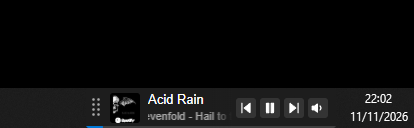
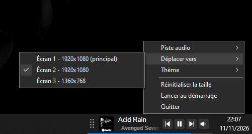

# SMTC Widget

Petit widget Windows (Tauri 2 + Preact + TypeScript) qui reste au-dessus de la barre des tâches et affiche la musique / media en cours de lecture via SMTC.



## Fonctionnalités

- Affiche le morceau en cours (titre et artiste défilants, pochette, progression) pour toute application compatible SMTC : Spotify, navigateurs, lecteurs vidéo…
- Contrôles précédent, lecture/pause et suivant, et volume réglable par application.
- Choix de la source audio quand plusieurs applications jouent en même temps.
- Thèmes Système, Clair, Sombre et Transparent (fond du widget invisible, la barre des tâches reste visible derrière).
- Redimensionnement en gardant les proportions, de 75 % à 200 %.
- Position et taille mémorisées séparément pour chaque écran, avec déplacement possible vers un autre écran.
- Placé par défaut juste à gauche de la zone de notification, et jamais plus bas que le bord de l'écran.
- Masqué automatiquement quand une application est en plein écran.
- Lancement automatique au démarrage de Windows (optionnel).

## Utilisation

- **Voir les contrôles** : survoler le widget.
- **Déplacer** : faire glisser la poignée à gauche du widget.
- **Redimensionner** : faire glisser le coin haut gauche. Un double-clic sur ce coin remet la taille d'origine.
- **Menu** : clic droit sur le widget pour choisir la piste audio, déplacer le widget vers un autre écran, changer de thème, réinitialiser la taille, activer le lancement au démarrage ou quitter.



## Installation

Une seule instance du widget peut tourner à la fois.

1. Construire l'installateur : `npm run tauri build` (voir les prérequis ci-dessous).
2. Lancer l'installateur NSIS généré dans `src-tauri/target/release/bundle/nsis/`.
3. Démarrer « smtc-widget » : le widget apparaît à gauche de la zone de notification. Le menu du clic droit permet de l'activer au démarrage de Windows.

Pour le désinstaller, passer par « Applications et fonctionnalités » de Windows. Les préférences et les journaux restent dans `%APPDATA%com.nockia.smtc-widget` et `%LOCALAPPDATA%com.nockia.smtc-widget`.

## Prérequis

- Windows 10 ou 11 (actuellement setup pour Windows 10)
- [Node.js](https://nodejs.org/) et npm
- [Rust](https://rustup.rs/) (via `rustup`) avec les Build Tools Visual Studio (charge de travail « Développement Desktop en C++ »)
- WebView2 (déjà présent avec Edge sur la plupart des machines)

## Installer les dépendances

```bash
npm install
```

## Lancer en développement

```bash
npm run tauri dev
```

La première compilation Rust est longue (plusieurs minutes). Un changement de `src-tauri/tauri.conf.json` ou du code Rust demande un redémarrage ou déclenche une recompilation ; le front (Preact) se recharge à chaud.

## Commandes utiles

| Commande                             | Rôle                                                                                                                 |
| ------------------------------------ | -------------------------------------------------------------------------------------------------------------------- |
| `npm run tauri dev`                  | Lance l'app en mode développement                                                                                    |
| `npm run tauri build`                | Exécutable (`src-tauri/target/release/smtc-widget.exe`) et installateurs (`src-tauri/target/release/bundle/`)        |
| `npm run tauri build -- --no-bundle` | Exécutable seul, sans installateur : plus rapide (mesures, tests en release)                                         |
| `npm run dev`                        | Lance seulement le front dans le navigateur (sans Tauri)                                                             |
| `npm run build`                      | Vérifie les types et construit le front                                                                              |
| `npm run format`                     | Formate le front et les fichiers de la racine avec Prettier (config : `.prettierrc`, exclusions : `.prettierignore`) |
| `npm run format:check`               | Vérifie le formatage sans rien modifier (code de sortie non nul si un fichier diffère)                               |
| `npm run lint`                       | Linter ESLint (config : `eslint.config.js`) ; `npm run lint:fix` applique les corrections automatiques               |

Côté Rust, depuis `src-tauri/` :

| Commande            | Rôle                                             |
| ------------------- | ------------------------------------------------ |
| `cargo check`       | Compile sans produire de binaire (rapide)        |
| `cargo clippy`      | Linter Rust (lints configurés dans `Cargo.toml`) |
| `cargo fmt`         | Formate le code (config : `rustfmt.toml`)        |
| `cargo fmt --check` | Vérifie le formatage sans rien modifier          |

## En cas d'erreur : journal de log

Si le widget affiche « Une erreur est survenue » (triangle rouge) ou se comporte de façon anormale,
le détail est dans le journal de log, écrit aussi bien en développement qu'en release :

```
%LOCALAPPDATA%\com.nockia.smtc-widget\logs\smtc-widget.log
```

- Le backend (Rust) et le front (préfixe `[front]`) écrivent dans le même fichier.
- Niveau `info` en release, `debug` en développement (où les logs sont aussi affichés dans la console).
- Le fichier est limité à 512 Ko : au-delà, il est archivé (un seul ancien fichier conservé, dans le même dossier) et un nouveau est créé.
- Les plantages (panic) y sont aussi consignés.
- Le front ne reçoit jamais le message d'erreur brut, seulement un code (`smtc_unavailable`, `internal`) :
  le détail complet n'existe que dans ce journal.
- Si le rendu plante, le widget affiche un repli puis réessaie seul au bout de 5 s ; le bouton ↻ force un nouvel essai.

## Structure

Le code est organisé **par feature** : chaque dossier de `features/` regroupe ses modèles,
sa logique et ses commandes Tauri.

```
src/                          Front Preact / TypeScript
  assets/icons/               Icônes SVG (importées comme composants via SVGR, couleur héritée du thème)
  components/
    ErrorBoundary/            Repli affiché si le rendu plante (réessai automatique + bouton)
    IconButton/               Bouton rond avec icône SVG
    SmtcWidget/               Widget (titre défilant, pochette, progression, volume, contrôles, poignée de déplacement, coin de redimensionnement)
  constants/                  Constantes partagées, un fichier par constante (EVENTS.ts…)
  hooks/                      useCurrentTrack, useTauriEvent, useAlbumArt, useHoverPanel, useSystemColors, useVolume…
  styles/                     Variables de couleur (_colors.css), reset, styles globaux
  types/                      Types partagés (*.types.ts) : morceau, couleurs système
  utils/                      Fonctions utilitaires (*.utils.ts) : appels de commandes, couleurs système, classes CSS, logger

src-tauri/                    Backend Rust et configuration Tauri
  tauri.conf.json             Configuration de la fenêtre et du build
  capabilities/               Permissions Tauri
  src/
    lib.rs                    Point d'entrée : plugins, setup, liste des commandes
    shared/                   Code commun : erreur de commande (AppError, code seul envoyé au front), manager SMTC partagé
    features/
      playback/               Morceau en cours, contrôles, pochette, écoute des événements SMTC
      audio_source/           Source audio choisie (état, liste des sources)
      volume/                 Volume par application (WASAPI), poussé au front à chaque changement
      window/                 Placement et taille par écran (redimensionnement par le coin haut gauche, proportions conservées), premier plan, plein écran, écrans branchés
      preferences/            Fichier de préférences unique (thème, position et taille par écran)
      appearance/             Thème appliqué (système, clair, sombre, transparent), couleurs système (barre des tâches, accent)
      context_menu/           Menu du clic droit (piste audio, écran, thème, taille, quitter)
```

Dans chaque feature, les fichiers sont répartis par rôle : `models.rs` (types),
`service.rs` (logique), `commands.rs` (commandes Tauri), `state.rs` (état partagé).
Les constantes restent en tête du fichier qui les utilise.

## Conventions front

- `*.utils.ts` : fonctions utilitaires ; `*.types.ts` : types partagés ; `<CONSTANTE>.ts` : une constante partagée par fichier.
- Imports : alias `@/` pour tout ce qui remonte dans l'arborescence, ordre vérifié par `npm run lint`.
- Les appels au backend passent uniquement par `commands` (`utils/commands.utils.ts`).
- Preact via `preact/compat` : les imports restent `from "react"` (alias fourni par `@preact/preset-vite`, repris dans `tsconfig.json` pour les types).

## Environnement de développement conseillé

- [Zed](https://zed.dev/) avec l'extension Rust (rust-analyzer est intégré)

## Licence

Distribué sous licence MIT, voir le fichier `LICENSE`.

## À propos de ce projet

Ce projet est aussi un terrain d'apprentissage, notamment pour Rust et Tauri. Je me suis appuyé en partie sur l'IA (Claude, d'Anthropic) pour me guider, relire mon code, comprendre des concepts (propriété, threads, `unsafe`, API Windows…) et trouver des pistes d'amélioration.

Le code peut donc être imparfait, je reste donc ouvert à tous les conseils et axes d'amélioration, que ce soit sur le code, l'architecture ou les bonnes pratiques, n'hésitez pas à ouvrir une issue ou une discussion.
